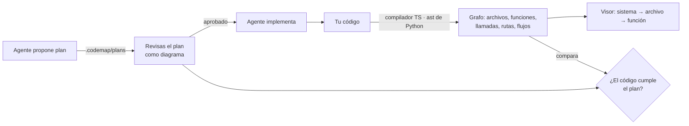

# codemap

**Revisa el código que escribe un agente de IA como diagrama, no línea por línea.**

Un agente escribe código más rápido de lo que una persona puede leerlo. codemap convierte el
proyecto en un mapa navegable —sistema → archivo → función → flujo interno— para entender en
pocos clics qué hace la app y qué cambió. Y con **diagrama primero**, el agente propone el flujo
*antes* de programar, tú lo apruebas como diagrama, y codemap comprueba que el código final hace
lo que se aprobó.

> Estado: prototipo (v0.1). Funciona en proyectos reales de TypeScript/JavaScript y Python, pero
> lo publicamos para recibir feedback antes de estabilizarlo. [Cuéntanos qué te falta](#feedback).

## Qué lo hace distinto

El diagrama **no lo dibuja un modelo**: sale del compilador de TypeScript y del `ast` de Python,
igual que "Ir a definición" en tu editor. Un diagrama que el modelo imagina puede describir lo que
quiso hacer y no lo que hizo; este no puede.



## Qué ves

| Vista | Qué muestra |
| --- | --- |
| **Sistema** | Un bloque por grupo de carpetas, sus dependencias reducidas a lo esencial, llamadas HTTP entre frontend y backend, APIs externas |
| **Todo el código** | Todas las funciones dentro de su archivo y grupo, con todas las llamadas; las más conectadas |
| **Archivo** | Sus funciones, a quién llaman fuera del archivo y quién las llama |
| **Función** | Su flujo interno como diagrama técnico: `IF`, `CALL`, `TRY/CATCH`, `LOOP`, `RES 400`… con número de línea |
| **Rastreo** | Todo lo que se ejecuta desde una ruta, un comando o una card, cruzando archivos |
| **Planes** | El plan propuesto junto al código actual: cada paso ✓ si el código lo hace, ✗ si falta |

Además: los bloques se arrastran (y los conectados los siguen), se resalta lo que cambió desde un
commit, avisos de lineamientos (`await` sin `try` en Express 4, `except` que se traga errores,
funciones largas, código sin documentar), y comentarios por paso que se copian como revisión
para el agente.

## Probarlo en 1 minuto (sin tocar tu código)

```bash
git clone https://github.com/MiorLear/codemap.git && cd codemap
npm install
npm run demo        # mapa de examples/demo en http://localhost:4321
```

El demo es una tienda pequeña: API de pedidos en Express, una card web y un worker en Python.
Incluye un plan de ejemplo (`pedidos-inventario-caido`) que todavía no está implementado, para que
veas cómo se marca lo que falta.

## Usarlo en tu proyecto

Requisitos: Node 18+, git, y Python 3.9+ si tu proyecto tiene Python (solo usa la librería
estándar; no hace falta el entorno de tu proyecto).

```bash
npm install -g github:MiorLear/codemap    # instala el comando `codemap`
cd tu-proyecto
codemap build                        # detecta el proyecto y genera .codemap/out/codemap.html
codemap serve --open                 # http://localhost:4321, se recarga solo
```

Sin configurar nada, codemap agrupa por carpetas (partiendo solo las que son grandes), detecta
los alias de `tsconfig`, los paquetes de un monorepo, las raíces de Python y si usas Express 4.
Para ajustarlo:

```bash
codemap init     # guarda lo detectado en .codemap/config.json
```

y edita los nombres de los grupos ("src/pedidos" → "Pedidos"), o pídeselo a tu
agente. Añade `.codemap/out/` a tu `.gitignore` (`init` lo hace por ti).

### Mapa de un solo archivo

```bash
codemap file src/pedidos/routes.ts            # el archivo y lo que importa directamente
codemap file worker/sync/cli.py --depth 2     # dos niveles de imports
```

Analiza el archivo y los archivos que importa (`--depth` niveles), y abre el visor directamente en
él. No necesita config ni recorrer el proyecto entero, así que sirve para entender un archivo
suelto de un repo enorme.

### Con Claude Code

```bash
codemap claude
```

Instala en el proyecto:

- **Un hook** que regenera el mapa después de cada edición del agente (en segundo plano, ~0,3 s
  de respuesta, una sola regeneración aunque edite 10 archivos seguidos). Con `codemap serve`
  abierto, el visor se recarga solo.
- **El skill "diagrama primero"**: antes de cambiar la lógica de una función, el agente escribe un
  plan en `.codemap/plans/<id>.json`, te pide revisarlo en el visor y espera a que lo apruebes.
  Al terminar ejecuta `codemap check <id>` y te dice qué pasos cumple.

Por defecto se instala en `.claude/settings.local.json` (solo para ti). Con `--shared`, en
`.claude/settings.json` para todo el equipo. Abre una sesión nueva de Claude Code para que cargue.

## Diagrama primero

Un plan describe, por cada función que se va a crear o modificar, los pasos de su flujo:

```json
{
  "funcion": "src/pedidos/routes.ts#GET /pedidos/:id",
  "accion": "modificar",
  "pasos": [
    { "si": "¿el id no es numérico?", "entonces": [{ "responde": 400 }] },
    { "intentar": [{ "hacer": "Cargar el pedido", "llama": ["cargarPedido"] }],
      "siFalla": [{ "responde": 502, "detalle": "El inventario no responde." }] },
    { "responde": 200 }
  ]
}
```

En el visor lo apruebas, pides cambios o comentas un paso concreto (se guarda en el archivo del
plan). `codemap check <id>` compara con el código:

```
Cumplimiento: 7/9 pasos verificables · faltan 2
  ✓ ¿el id no es numérico?
  ✗ intentar             ← El código no tiene try/catch
  ✓ Cargar el pedido
  ✗ responde 502         ← El código nunca responde 502
  + Llama a resumen, que el plan no menciona
```

Se verifica la **forma** del flujo: que llame a esas funciones, que responda esos códigos, que haya
`try/catch`, bucles y suficientes decisiones. El texto de un paso (`"Registrar el error"`) es para
la persona y no se verifica.

## Qué es fiable y qué no

| Qué | De dónde sale | ¿Puede estar mal? |
| --- | --- | --- |
| Archivos, imports, llamadas (TS/JS) | Compilador de TypeScript | No: resuelto contra la declaración |
| Archivos, imports, llamadas (Python) | `ast` de Python, con imports perezosos por función | Llamadas sobre objetos cuyo tipo solo se sabe al ejecutar (`motor.leer()`) no se resuelven |
| Rutas de Express y su prefijo | `router.get(...)` + `app.use("/prefijo", ...)` hasta el servidor | Montajes dinámicos |
| Rutas de FastAPI, comandos de argparse | Decoradores y `add_parser` + `set_defaults(func=...)` | Si se registran de otra forma |
| Frontend → backend | `fetch(\`${BASE}/api/...\`)` emparejado con la ruta | Si la URL se arma en otro sitio |
| Flujo interno | AST de la función | No |
| Qué cambió | `git diff` por rangos de línea | No |
| Descripciones | Comentarios de documentación del código | Si faltan, la función sale "sin descripción" |
| Avisos | Reglas heurísticas | Señalan qué revisar, no sentencian |

## Configuración

`.codemap/config.json` (lo crea `codemap init`):

```jsonc
{
  "name": "Mi proyecto",
  "base": "HEAD",                         // contra qué se resaltan los cambios ("main" para ver la rama)
  "include": ["src/", "worker/"],         // carpetas que entran al mapa
  "exclude": ["/tests/", ".test."],       // patrones que se ignoran
  "groups": [                             // bloques de la vista Sistema (gana el prefijo más largo)
    { "id": "pedidos", "prefix": "src/pedidos/", "name": "Pedidos", "layer": "api", "desc": "…" }
  ],
  "layers": [{ "id": "web", "name": "Cliente" }, { "id": "api", "name": "API" }],
  "paths": { "@acme/contracts": ["packages/contracts/src/index.ts"] },
  "python": { "cmd": "python", "roots": ["worker"] },
  "rules": { "longFunctionLines": 80, "express4AsyncErrors": true }
}
```

## Comandos

| Comando | Qué hace |
| --- | --- |
| `codemap build [--base main]` | Genera el mapa del proyecto |
| `codemap file <ruta> [--depth n]` | Mapa de un archivo y lo que importa |
| `codemap serve [--port 4321] [--open]` | Sirve el mapa, recarga sola, guarda la revisión de planes (solo en 127.0.0.1) |
| `codemap check <plan>` | Compara el código con un plan |
| `codemap init [--force]` | Guarda la config detectada para editarla |
| `codemap claude [--shared]` | Instala el hook y el skill de Claude Code |

## Proyectos parecidos

Hay buen trabajo de la comunidad en esta dirección. Según sus READMEs:

- [Architect](https://github.com/willhennessy/architect) — diagrama de arquitectura en el modo plan
  de Claude Code, con comentarios por nodo. Lo genera el modelo y se centra en planear.
- [review-suite (xmandeng)](https://github.com/xmandeng/claude-plugins) — revisión de planes por
  sección, mapa de arquitectura arrastrable con feedback por nodo que vuelve a la sesión. Los
  diagramas salen del análisis del modelo.
- [flow-diagram](https://github.com/wrode/flow-diagram) — skill que traza el flujo de datos y genera
  diagramas HTML interactivos.
- [CodeGraph](https://github.com/colbymchenry/codegraph) — grafo del código por análisis estático,
  pensado para que lo consuma el agente.

codemap combina análisis estático (no diagramas imaginados) con revisión humana, baja hasta el flujo
de cada función y **verifica el código contra el plan aprobado**. Si conoces otro que ya lo haga,
dínoslo: preferimos sumarnos a duplicar.

## Limitaciones conocidas

- Lenguajes: TypeScript, JavaScript y Python. Nada más por ahora.
- Frameworks reconocidos: Express (rutas y montajes), FastAPI (rutas), argparse (comandos). Otros
  frameworks salen como funciones normales, sin sus rutas.
- Proyectos muy grandes: probado hasta ~100 archivos y ~650 funciones (2 s). Más allá, no lo sabemos.
- El visor carga Cytoscape, ELK y las fuentes desde CDN: sin internet no se dibuja.
- Las disposiciones que acomodas a mano se guardan en tu navegador, no en el repo.

## Feedback

Lo que más nos ayuda saber:

1. **¿Te ayudó a revisar más rápido** lo que escribió un agente? ¿En qué vista te quedaste más tiempo?
2. **¿El mapa de tu proyecto tiene sentido** tal cual sale de `codemap build`, sin configurar? ¿Qué agrupó mal?
3. **¿Usarías diagrama primero** en tu día a día o es demasiada fricción? ¿Qué cambiarías del formato del plan?
4. **¿Qué framework o lenguaje** necesitas para probarlo en tu proyecto real?
5. ¿Algo se rompió? Dinos el comando y pega la salida.

Abre un [issue](../../issues/new/choose) con la plantilla de feedback; no hace falta que sea largo.

## Desarrollo

```bash
npm install
npm test            # pruebas de extremo a extremo sobre examples/demo
npm run demo
```

```
bin/codemap.mjs      CLI
src/project.mjs      dónde vive cada cosa y detección automática de la config
src/build.mjs        análisis TS/JS, rutas, llamadas, flujos, cambios → graph.json + visor
src/py_extract.py    lo mismo para Python, con el ast de la librería estándar
src/plans.mjs        planes de "diagrama primero" y su comparación con el código
src/viewer.html      el visor (una sola página; Cytoscape + ELK)
src/serve.mjs        servidor local: recarga y revisión de planes
src/hook.mjs         hook de Claude Code
templates/SKILL.md   skill "diagrama primero" que instala `codemap claude`
examples/demo/       proyecto de ejemplo y plan de muestra
```

## Licencia

[MIT](LICENSE) © 2026 Miguel Ledezma
